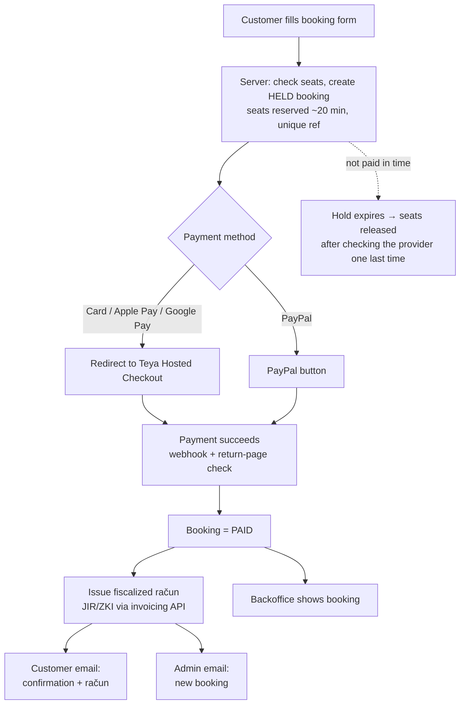

# Bookings, payments, email and backoffice: plan

**Status:** draft, waiting for decisions · **Written:** 2026-10-11 · **Research:** 4 parallel investigations (codebase, email, backoffice, payments/law). Sources are at the bottom.

The boss asked for three things:

1. a confirmation email to the buyer
2. a notification email to the business
3. a backoffice where bookings are easy to read and manage

Payments use **Teya** (primary; the account exists) and **PayPal** (secondary). Stripe is out.

> **Update 2026-10-11: showcase first.** The first goal is a complete **demo** for the boss. Real payments, fiscalization and overbooking protection come later. Answers so far:
> - **Fiscalization:** delayed.
> - **Teya credentials and e-commerce:** delayed.
> - **Email order:** confirmation after payment. Agreed.
> - **Booking foundations (Phase 1):** delayed.
> - **Email for now:** a demo outbox.
> - **Backoffice:** the recommended direction. Agreed.
> - **Netlify plan:** no subscriptions, stay on Free.
>
> What the showcase contains is described in §0. The rest of this doc is the plan for the real version.

## 0. The showcase (branch `feat/booking-showcase-mock`)

**What's real (stays when we go live):**
- **Bookings are stored,** with a unique random ref (`HBC-7K3QXM`), a price recomputed on the server, and server-side validation.
- **Customer pages read the booking from storage.** Personal data is no longer passed into the payment and success pages.
- **One "paid" step for everything after payment:** booking confirmed, račun issued, customer confirmation and admin notification sent. It runs once, even if called twice.
- **Contact enquiries are stored,** and the admin gets an email for each one.
- **Admin at `/admin`** (mobile first: bottom tab bar on phones, sidebar on computers):
  - the Today/Tomorrow passenger list per departure, with seats out of 12 and call/WhatsApp buttons
  - the bookings list grouped by day, with search and filters
  - booking detail with status changes, notes, mark-refunded, resend the confirmation, and a history log
  - the enquiry inbox
  - the email outbox with a preview of each email
  - a **More** page with CSV export, email settings, demo data tools and log out
- **Copy:** the Stripe mentions are replaced with Teya/PayPal.

**What's mocked:**

| Mocked | How | Replaced in |
|---|---|---|
| Payment | `/booking/pay/` page with "Pay" and "simulate declined" buttons; the Teya/PayPal choice is recorded | Phases 2 and 6 |
| Račun | Sequential number, random JIR/ZKI, labelled "DEMO, not fiscalized" | Phase 3 |
| Email delivery | Emails are recorded in the admin outbox and not sent. Real sending through Resend needs `RESEND_API_KEY` **and** `EMAIL_SENDING=on` in Netlify (test sender until `EMAIL_FROM` is on our own domain); without both, emails are quietly only saved | Phase 4 |
| Storage | Netlify Blobs (free, no account), no transactions | Phase 1 (D15) |
| Admin login | One shared password (`ADMIN_PASSWORD`; `demo` in local dev) | Phase 5 (D17) |
| Seats | Counted and shown, but not enforced | Phase 1 |

**Known showcase limits, to fix before launch:**
- **"Load demo data" and "Delete everything"** must be removed or hidden once real bookings exist. Previews and branch deploys already get their own data store; production uses its own.
- **The booking calendar uses the visitor's own timezone,** while the server checks dates in Split time. The server rejects a past date with a message, but the calendar should use Split time too.
- **Phone numbers in the CSV export start with an apostrophe** (`'+385…`). That's the spreadsheet-formula protection; Excel shows it.
- **Set `ADMIN_SESSION_SECRET` in Netlify.** Without it, login cookies are signed with a key derived from the password.
- **The success page shows the guest's phone and notes** to anyone who has the link. The link contains a random ID that can't be guessed. Trim the page before launch.
- **While `PAYMENTS_ARE_DEMO` is on** (`src/config/payments.ts`), real email only goes to `ADMIN_EMAIL` and `EMAIL_DEMO_ALLOWLIST`, even with Resend set up.

**How to demo it:**
1. Set `ADMIN_PASSWORD` (and `ADMIN_SESSION_SECRET`) in Netlify and deploy. Locally, `pnpm dev` and the password `demo`.
2. Open `/admin`, then **More → Load demo data** (about three weeks of bookings).
3. Book a tour on the site and pay on the demo page.
4. Show the booking appearing in the admin and the two emails in **Emails**.

> **How to use this doc:** each open decision has a `✏️ Answer:` line. Fill them in, and tick the boxes in the Phase 0 checklist as you go. Items marked ⭐ are my recommendation; nothing is locked in until you answer. Tasks list the decisions they depend on, e.g. `needs D3`.

---

## 1. Where we start from (facts from the code)

The site **looks** like it takes bookings, but nothing behind it is real yet:

| Today | Where | What it means |
|---|---|---|
| "Continue to payment" is a plain link to the success page | `src/pages/book/[slug]/review.astro:244` | No payment, no stored booking |
| All booking data (name, email, phone) travels in the URL | `GroupBookingFlow.vue:224`, `review.astro`, `success.astro:21-54` | Personal data ends up in browser history and logs, and anyone can craft a "confirmed" page |
| Success page says "Confirmation sent to …" | `src/pages/booking/success.astro:77-86` | No email is sent |
| Booking ref is a hash of the details, mod 100000 | `src/lib/booking.ts:167` | Not unique; collisions happen |
| Max 12 guests is checked **per booking**, not per departure | `src/lib/booking.ts:5` | Overbooking is possible |
| Price always uses the peak-season figure | `src/lib/price.ts`, `tour-catalog.ts:49-56` | Low-season customers would be overcharged |
| Contact form validates the message, then throws it away | `src/pages/api/contact.ts:115` | Enquiries are lost today |
| "Stripe" appears in 6 places | `review.astro:250`, `faq.ts:45`, `privacy.astro:45,62,90`, `terms.astro:88` | Wrong once we use Teya and PayPal |
| Privacy page claims Google Analytics and cookies that don't exist | `privacy.astro:95-97,112-138` | Needs correcting |

**Good news:** the old branch `feat/payments-and-deploy` (June 2026) already had working drafts of:

- Teya Hosted Checkout (`lib/teya.ts`)
- PayPal Orders v2 with webhook verification
- an idempotent "mark paid → send emails once" function (`lib/payments/finalize.ts`)
- guest and ops email templates
- a reservations table

It can't be merged because the site changed too much since June, but those pieces will be **ported by hand**. That saves a few days.

**Bookable tours today:** 4 instant-book tours, each with a price:

- `blue-cave-hvar-5-islands` €169
- `golden-horn-brac-hvar` €139
- `blue-lagoon-morning` €75
- `blue-lagoon-afternoon` €75

3 tours are quote-only and go through the contact form: `hvar-red-rocks-pakleni`, `dubrovnik-one-way` and `create-perfect-day-private`.

---

## 2. The target flow

The industry norm, used by FareHarbor, Bókun and others, is to send the confirmation **after** payment succeeds. The customer gets **one** email holding both the confirmation and the bill.

**About "confirmation before the bill":** we don't email anything before payment. An unpaid "booking" would only confuse people. The bill (the račun) arrives in the same email as the confirmation, straight after payment.

**Private charters** go through a different path:

1. The customer sends a request.
2. The boss writes a quote in the backoffice.
3. One click emails a **Teya payment link**.
4. Payment arrives.
5. The same confirmation, račun and admin email go out.

---

## 3. Key research findings

### ⚠️ Fiscalization: the blocker nobody asked about
Since **1 Jan 2026** (Zakon o fiskalizaciji, NN 89/25), **every sale to a consumer must get a fiscalized račun** with JIR, ZKI and a QR code. That covers card, PayPal and bank transfer alike.

- **Neither Teya's nor PayPal's receipt counts.** They are payment slips with no JIR.
- **Fines run from €1,320 to €66,360.**
- So the site must call an invoicing/fiscalization service after each payment.
- **A Croatian accountant must confirm the details** before we build this step. See D1–D3.

### Teya can do online payments, with conditions
- **What it offers:** public docs (docs.teya.com) describe Hosted Checkout (redirect), the Pay by Link API, refunds, pre-authorisation, a staging environment and webhooks signed with RSA.
- **Needs an e-commerce subscription** on top of the POS account. **The existing credentials may only be POS/portal logins.** Check this first (Phase 0).
- **Webhooks:** Teya only sends **successful payment** webhooks (`payment.succeeded.v1`). Failures and expiries must be checked by polling the API.
- **Fees:** online card fees aren't published. Ask Teya.

### PayPal works, but it's the expensive option
- **Fees in HR:** **3.40% + €0.35** for EEA payments, 5.39% + €0.35 for non-EEA.
- **Refunds:** **PayPal keeps its fee when you refund.** With free cancellation, that's money lost.
- **Card fields without a PayPal account:** PayPal's "advanced card fields" aren't available for Croatian merchants. Teya stays the card option; PayPal is only for people who want to pay with their PayPal account.

### Email: free is fine, but a domain is required
- **⭐ Brevo free:** 300 emails a day, EU-hosted, and the boss can edit templates.
- **Runner-up: Resend free:** 100 a day, the nicest for developers, can send from the EU (Ireland).
- **Expected volume:** about 1,000–1,500 emails a month in peak season. That fits either free tier.
- **We can't send customer email from `hello-blue-cave.netlify.app`**, because nobody can add DNS records to netlify.app. **The new domain must exist before launch.**
- **Netlify's own email integration closed to new teams in Sep 2026.** Don't use it.

### Backoffice: build it into the site
- **⭐ Recommendation:** a mobile-first `/admin` area in this same Astro/Vue app.
  - **Bookings:** stored in a **Neon Postgres database in Frankfurt**. Free tier, EU, and a database transaction makes overbooking impossible.
  - **Login:** **Netlify Identity** (free, invite-only users). Netlify reversed its deprecation in Feb 2026; re-check this at build time.
- **Alternatives:**
  - **Netlify Blobs only:** "pure Netlify", but no search or transactions, and more hand-written code.
  - **Netlify Database:** effectively $9 a month, because the free plan has a hard compute cap.
- **Ruled out:**
  - Airtable and Google Sheets: free limits too small, or no safe seat counting.
  - Teya and PayPal dashboards: payments only, no guest lists or capacity.
  - Headless CMSes: the wrong tool.

### Buy instead of build?
- **No major booking platform supports Teya.** I checked FareHarbor, Bókun, Rezdy, Checkfront, Bookeo, TuriTop and others. Many support PayPal.
- **None of them fiscalize for Croatia** either.
- **Buying only makes sense if you want GetYourGuide/Viator channel sync.** Bókun START, for example, is $49 a month + 1.5% per booking, and you couldn't use Teya. See D4.

### Hosting risk
- **Netlify Free gives 300 credits a month, and the site pauses when they run out.** A deploy costs 15 credits, and functions and bandwidth use more.
- **A booking site going offline in August is a real risk.** See D16.

---

## 4. Open decisions (fill these in)

### Business and legal (ask the accountant)

**D1. Legal form and VAT status.** Is the business a d.o.o. or an obrt? In the VAT system, or paušalist?
✏️ Answer:

**D2. VAT rate on tours.** Sources suggest 25% for day excursions, but 13% covers some nautical/accommodation cases, and a non-VAT paušalist charges none.
✏️ Answer (accountant):

**D3. Fiscalization / invoicing tool.** *(Delayed. The showcase uses a demo račun.)* Who issues the račun after an online payment?
- ⭐ **a)** Solo+ API, €40 a month incl. VAT, 600 invoices included. Its API returns the JIR, ZKI and a PDF.
- **b)** Whatever software the accountant already uses, if it has an API.
- **c)** FIRA or another tool (prices not checked).

Also: who holds the fiscal certificate and the business-premises and device codes (*oznaka poslovnog prostora / naplatnog uređaja*)?
✏️ Answer:

**D4. Build or buy?** Do you want bookings to sync with GetYourGuide/Viator?
- ⭐ **a)** No, direct bookings only → build it, as in this plan.
- **b)** Yes → look at Bókun. That means no Teya, so PayPal or another processor.

✏️ Answer:

### Payments

**D5. Teya e-commerce.** *(Delayed.)* Is the Online Payments subscription active? Can Teya give us staging credentials? What does it cost, and what is the online card fee? *(Questions for Teya are in §5.)*
✏️ Answer:

**D6. PayPal at launch?** It costs more and keeps its fee when you refund.
- **a)** Yes, at launch.
- ⭐ **b)** Teya only at launch; add PayPal in the second phase if customers ask.
- **c)** Never.

✏️ Answer:

**D7. Pay in full or a deposit?**
- ⭐ **a)** Full payment at booking; refund through the API when someone cancels ≥48h ahead. Simplest, and one račun plus one storno.
- **b)** Deposit now, the rest later or on board. Double the invoicing and reconciliation work.

The terms already say the full price for group tours and a 30% deposit for private charters (`terms.astro:60-84`). Keep that?
✏️ Answer:

**D8. Seasonal pricing.** Today the site always charges the peak price. Should the price depend on the date (low/peak season from `priceNotes`), and what are the exact date ranges and prices per tour?
✏️ Answer:

**D9. Cancellation rules in detail.**
- Free cancellation up to 48h: full refund?
- Weather cancellation by us (4h notice): full refund or a reschedule?
- No-shows: no refund?
- Who can trigger a refund, the boss only or staff too?

✏️ Answer:

**D10. Seat hold time** while the customer pays. ⭐ 20 minutes (Teya's checkout session lives 15).
✏️ Answer:

### Domain and email

**D11. New domain.** What's the name, and who registers it? ⭐ Register with Cloudflare or a registrar, with DNS on Cloudflare. That gives free inbox forwarding (Email Routing) and allows Cloudflare Access later.
✏️ Answer:

**D12. Email provider.** *(Answer 2026-10-12: **Resend**. It's wired in and switched on by `RESEND_API_KEY`; Brevo was removed.)*
- ⭐ **a)** Brevo free: 300/day, EU, owner-editable templates.
- **b)** Resend free: 100/day, nicer developer experience.

✏️ Answer:

**D13. Addresses.**
- **Sender:** e.g. `bookings@<domain>`, display name "Hello Blue Cave".
- **Customer replies:** should go to …
- **Admin notifications:** go to … The site currently lists `info@hellobluecave.com` (`src/config/site.ts:5`). Keep that inbox or use a new-domain address?
- **Same or separate inboxes** for bookings and contact enquiries?

✏️ Answer:

**D14. Email content.**
- Languages at launch: ⭐ English only, with the language stored on each booking for later.
- Reminder email the day before (time of day?).
- Auto-reply to contact-form senders.
- Should Teya also send its own (non-fiscal) card receipt? ⭐ No; ours carries the račun.

✏️ Answer:

### Backoffice and hosting

**D15. Where bookings are stored.** *(Showcase: Netlify Blobs. The real version is still open.)*
- ⭐ **a)** Neon Postgres, Frankfurt, free.
- **b)** Netlify Blobs only.
- **c)** Netlify Database, about $9 a month.

✏️ Answer:

**D16. Netlify plan.** Free can pause the site when credits run out. *(Answer 2026-10-11: no subscriptions, stay on Free.)*
- **a)** Stay on Free and watch usage.
- ⭐ **b)** Personal, $9 a month, before the season.
- **c)** Pro, $20 a month. Allows functions in Frankfurt (EU) and password protection.

✏️ Answer:

**D17. Admin login and users.**
- **Who gets access?** Name each person and their role: owner or staff.
- **Is two-step login (MFA) required?**
  - ⭐ Netlify Identity, free, no MFA found.
  - Our own login with authenticator-app codes.
  - Auth0 free, which includes MFA.

✏️ Answer:

**D18. What the boss wants on his phone first.** ⭐ MVP:
- today/tomorrow passenger list per departure with tap-to-call/WhatsApp
- booking detail with status buttons and notes
- the enquiry inbox
- closing a departure or blocking a date
- CSV export

Anything missing, or anything he doesn't need?
✏️ Answer:

**D19. Data retention (GDPR).** How long do we keep guests' personal data after the tour? The privacy page currently says 5 years for financial records. Accounting data stays; names, phone numbers and notes could be anonymised after N months.
✏️ Answer:

**D20. Notifications beyond email.** Does the boss also want WhatsApp or SMS alerts for new bookings? That's later, and may cost money.
✏️ Answer:

---

## 5. Questions to send out

### To Teya support / Business Portal
1. Does our account have the **Online Payments (e-commerce) subscription** for Croatia? What does it cost, and what are the online card fees (EEA, non-EEA, Amex, Apple/Google Pay)?
2. Please set up a **staging store** with API credentials (Client ID and Secret) and webhook configuration. Which store ID do we use?
3. Are webhook events other than `payment.succeeded.v1` planned (failed, refunded, expired)?
4. Can **DCC** (dynamic currency conversion) be turned off for our store?
5. Do you offer **fiscalization of online transactions in Croatia**, or a partner that does?
6. What are the API rate limits, and how long does a production OAuth token last?
7. Is there a settlement/reporting API for reconciliation?

### To the accountant
1. Our legal form and VAT status (D1). Which PDV rate applies to group boat excursions and to private charters (D2)?
2. Online card (Teya) and PayPal payments to consumers: confirm that each needs an F1 fiscalized račun, and what payment method code to use for PayPal.
3. Which invoicing tool should we connect to (D3)? Our business-premises and device codes, and the invoice number format.
4. How should cancellations and refunds be invoiced (storno), and what about cancellation fees we keep?
5. Business customers (agencies) paying by bank transfer need an eRačun (Fiskalizacija 2.0). Can the chosen tool do that?
6. During a Tax Administration outage, how long can fiscalization be delayed?

---

## 6. To-do list (phased)

Estimates are developer days. The total for the MVP is roughly **15–22 days** after Phase 0.

### Phase 0: prerequisites (no code; owner and accountant)
- [ ] Accountant answers §5 → fill in D1–D3, D9
- [ ] Teya answers §5 → fill in D5; get **staging credentials**
- [ ] Register the domain (D11) and point it at Netlify
- [ ] Set up the inboxes / forwarding for the admin addresses (D13)
- [ ] Choose the Netlify plan (D16)
- [ ] Merge the open PR `perf/icons-images-links-config`. Its CSP and CI changes are the base for all of this
- [ ] Re-check at build time: that Netlify Identity is still supported, and Brevo's free limits in the dashboard

### Phase 1: booking foundations (~3–4 days) · needs D8, D10, D15
- [ ] Set up the database (Neon EU, or Blobs per D15), with tables for departures, bookings, payments, payment_events, enquiries, booking_notes, audit_log (model in §7)
- [ ] `POST /api/bookings`: validate on the server (email format, past dates, guest counts), recompute the price from **numeric** price data (not display strings), check capacity and create a **HELD** booking with seats reserved, all in one transaction
- [ ] Generate a unique random booking ref (e.g. `HBC-7K3Q`) to replace `bookingRefFromDetails`
- [ ] Remove personal data from the URLs. Pages load the booking by ID from the server
- [ ] Rewrite `/booking/success` to show the real status from the database (paid / pending / failed)
- [ ] A scheduled function releases expired holds, after asking the provider once more about payment status
- [ ] Store contact enquiries in the database (they are lost today)
- [ ] Add the new routes to `ROBOTS_DISALLOW` and `NOINDEX_PATH_PREFIXES` (the `noindex.test.ts` test enforces this). Add `Cache-Control: no-store` for `/api/*`, `/booking/*` and `/admin/*`
- [ ] Set `region: 'eu-central-1'` on every Netlify Blobs call, including `rate-limit.ts` (IP addresses are personal data)
- [ ] Tests for capacity under concurrent bookings, price, ref uniqueness and hold expiry

### Phase 2: Teya payments (~2–3 days) · needs D5, D7
- [ ] Port and refresh `lib/teya.ts` from the old branch: OAuth token cache, the required `User-Agent`, `POST /v2/checkout/sessions` with `Idempotency-Key` = booking ID, `merchant_reference` = booking ref, `language`
- [ ] Review page: "Continue to payment" becomes a POST that creates the session and redirects to Teya
- [ ] Webhook `/api/teya/webhook`: verify the RSA signature on the **raw** body, deduplicate on `transaction_id`, answer 200 quickly, then process
- [ ] Return-page check (`GET /v2/checkout/sessions/{id}`), because Teya sends no failure webhooks
- [ ] One shared idempotent `finalizeBooking()` (ported from the old `finalize.ts`): PAID → račun → emails, exactly once
- [ ] Late payment for released seats: automatic refund and an alert to the boss
- [ ] Test on Teya staging with their test cards (3DS frictionless, challenge, decline)

### Phase 3: fiscalization (~1–2 days) · needs D1–D3
- [ ] `lib/fiscal.ts` behind one interface, so the provider can be swapped: issue the račun (Solo+ `POST /racun` or the accountant's tool) and store the JIR, ZKI and PDF link on the booking
- [ ] A storno račun on refund
- [ ] If fiscalization fails: still confirm the booking, retry in the background, alert the boss, and send the račun when it's ready
- [ ] Have the accountant check a test račun before going live

### Phase 4: email (~1.5–2 days) · needs D11–D14
- [ ] Set up Brevo or Resend: SPF, DKIM and DMARC (`p=none`) on the new domain, with **one** merged SPF record
- [ ] `lib/email.ts` with a single `sendEmail()` (easy to swap providers; a failed send never fails the booking; logged and retried)
- [ ] Customer **booking confirmation**: tour, date, check-in time, meeting point, guests, total paid, ref, what to bring, cancellation policy, and the račun attached or linked
- [ ] **Admin notification** for each paid booking (Reply-To = customer) and each contact enquiry
- [ ] Optional per D14: contact auto-reply; a reminder the day before through a scheduled function
- [ ] Every email gets a plain-text version; test with mail-tester.com and real Gmail and Outlook inboxes

### Phase 5: backoffice MVP (~5–7 days) · needs D15, D17, D18
- [ ] `/admin` login (per D17); invite the boss and staff
- [ ] **Today / Tomorrow** screen: each departure with seats taken out of 12, the passenger list, and tap-to-call/WhatsApp. Big text, phone-first
- [ ] Bookings list with date and status filters, plus search by name, email, phone or ref
- [ ] Booking detail: status buttons (confirmed / cancelled / no-show / completed), internal notes, resend the confirmation, and a link to the Teya/PayPal transaction
- [ ] Enquiries inbox (new / replied / converted / closed)
- [ ] Close a departure or block a date (weather, maintenance)
- [ ] CSV export (for the accountant)
- [ ] Audit log written automatically for every change
- [ ] Private charters: write a quote, then **send a Teya payment link** (Pay by Link API)
- [ ] Walk the boss through it on his own phone and adjust

### Phase 6: PayPal (~1.5–2 days) · only if D6 = a or b
- [ ] Port `lib/paypal.ts` from the old branch: Orders v2 create and capture, `custom_id` = booking ID, the `PayPal-Request-Id` header
- [ ] Webhook with signature verification; act on `PAYMENT.CAPTURE.COMPLETED` (plus DENIED and REFUNDED for status)
- [ ] CSP: allow `*.paypal.com` and `*.paypalobjects.com` (script, frame, connect, img)
- [ ] A payment-method choice on the review page

### Phase 7: copy and legal (~0.5–1 day)
- [ ] Replace the 6 Stripe mentions with Teya/PayPal (`review.astro:250`, `faq.ts:45`, `privacy.astro:45,62,90`, `terms.astro:88`)
- [ ] Privacy policy: list the processors (Teya, PayPal, the email provider, the database host, Netlify, the invoicing tool), remove the claims about Google Analytics and cookies that don't exist, set the retention period (D19), and update "Last updated"
- [ ] FAQ / terms: say the confirmation arrives after payment and include the račun; align the refund wording with D9
- [ ] `booking/error.astro`: make the "spots held" text match the real hold time
- [ ] Sign the DPAs (data processing agreements) with each processor

### Phase 8: launch checklist
- [ ] End-to-end on staging: book, pay, račun, both emails, appears in admin, cancel, refund, storno
- [ ] Two people booking the last seats at the same moment → no overbooking
- [ ] Switch Teya and PayPal to live credentials; send a real €1 test payment, then refund it
- [ ] Turn on the Turnstile keys (the CSP allows Turnstile once PR `perf/icons-images-links-config` is merged)
- [ ] Monitor the first week: webhook failures, email bounces, fiscal errors

### Later (v1.1 / v2)
- Refunds started from inside the admin through the APIs
- Weather cancellation of a departure with a bulk email to its guests
- Daily payment reconciliation against Teya and PayPal
- HR/DE/IT emails
- Add the admin to the phone's home screen
- Google Sheets mirror of the manifest
- Agent/partner bookings
- Revenue stats

---

## 7. Data model sketch (Postgres)

- **departures**: tour, date, slot, capacity (12), status (open / closed / cancelled), note. Unique on (tour, date, slot).
- **bookings**:
  - ref, type (group / private), departure, adults, children, seats
  - customer name, email, phone, notes
  - total, currency
  - `status`: held / pending_payment / confirmed / cancelled / completed / no_show / expired
  - `payment_status`: unpaid / paid / partially_refunded / refunded / failed
  - hold_expires_at, language, source (web / phone / walk-in / partner)
  - fiscal JIR / ZKI / račun URL
  - timestamps, deleted_at
- **payments**: booking, provider (teya / paypal), provider checkout ID, provider payment ID, amount, status, refunded amount, last event.
- **payment_events**: provider event ID (unique, for idempotency), type, payload, processed_at.
- **enquiries**: name, email, phone, tour, wanted date, guests, message, status (new / replied / converted / closed / spam), linked booking.
- **booking_notes**, **audit_log**, **staff**.

**Seat rule:** taken = the seats of bookings that are confirmed, or held and not yet expired. The check and the insert happen in one transaction that locks the departure row.

---

## 8. Risks

| Risk | Mitigation |
|---|---|
| Selling without a fiscalized račun → fines of €1,320–€66,360 | Phase 3 before launch; the accountant signs off |
| Existing Teya creds turn out to be POS-only | Ask Teya now (Phase 0); it gates Phase 2 |
| Teya only sends success webhooks | Return-page check plus reconciliation in the hold-release job |
| Overbooking | Database transaction plus a concurrency test |
| Site paused when Netlify credits run out in season | D16 |
| Free email tier changes or a daily cap is hit | Everything goes through one `sendEmail()`; monitor; Brevo's 300/day gives headroom |
| PayPal fees lost on refunds | D6 |
| Webhook signature checks failing on a modified body | Read the raw body once; tests |
| Teya API reference is labelled "beta" | Keep the Teya code behind one module; staging tests |

---

## 9. Sources (accessed 2026-10-11)

- **Teya:**
  - docs.teya.com/online-payments/overview
  - …/hosted-checkout/get-started
  - …/webhooks
  - …/payment-actions
  - …/testing
  - …/pay-by-link/api
  - teya.com/hr/online-payments
  - teya.com/hr/pricing
  - help.teya.com returned 403
- **PayPal:**
  - paypal.com/hr/webapps/mpp/merchant-fees
  - developer.paypal.com/docs/checkout/advanced/eligibility/
  - developer.paypal.com/api/rest/webhooks/rest/
  - developer.paypal.com/sdk/js/csp/
- **Fiscalization:**
  - zakon.hr/z/3960/zakon-o-fiskalizaciji
  - porezna-uprava.gov.hr/Misljenja/Detaljno/2647
  - fiskalopedija.hr/baza-znanja/fiskalizacija-webshopa
  - solo.com.hr/paketi-i-cijene
  - solo.com.hr/api-dokumentacija/izrada-racuna
- **Email:**
  - resend.com/pricing and /docs/dashboard/domains/regions
  - Brevo pricing (secondary sources; confirm in the dashboard)
  - mailjet.com/pricing
  - docs.netlify.com/extend/install-and-use/setup-guides/email-integration/
  - developers.cloudflare.com/email-routing/
  - support.google.com/a/answer/81126
- **Netlify:**
  - netlify.com/pricing
  - docs.netlify.com: Blobs, Netlify Database billing, Identity overview, password protection
  - netlify.com/changelog/2026-04-28-netlify-database/
  - answers.netlify.com thread on the Identity reversal (Feb 2026)
- **Databases:** neon.com/pricing, supabase.com/pricing, support.airtable.com/docs/airtable-plans, developers.google.com/workspace/sheets/api/limits
- **Booking platforms:** bokun.io/pricing, bookeo.com/tours/pricing, help.turitop.com (PayPal Commerce Platform). FareHarbor and Regiondo figures are from third-party comparisons.
